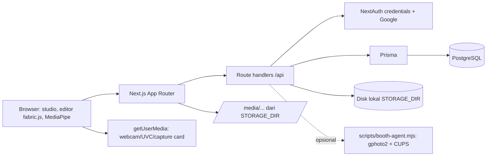
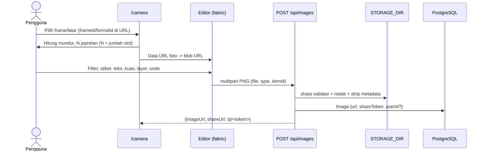

# Arsitektur PBOX

Batas komponen dan aliran data pada kode per 27 Oktober 2026. Instalasi: [SETUP.md](../SETUP.md). Status dan risiko: [HANDOFF.md](HANDOFF.md).

## Gambaran sistem

ImageKit dan Pinata sudah dihapus. File disimpan ke disk lokal, jadi deployment harus memakai volume persisten (VPS/Docker). `compose.yaml` masih hanya berisi PostgreSQL.

## Batas komponen

| Bagian | Lokasi | Tanggung jawab |
| --- | --- | --- |
| Layout, tema, SEO | `src/app/layout.tsx`, `src/lib/site.ts`, `robots.ts`, `sitemap.ts`, `manifest.ts`, `opengraph-image.tsx`, `twitter-image.tsx`, `llms.txt/route.ts` | Metadata, OG/Twitter, PWA manifest, robots, sitemap, llms.txt |
| Landing | `src/app/page.tsx`, `Hero.tsx`, `HowItWorks.tsx` | Konten publik + JSON-LD (WebSite, WebApplication, FAQPage) |
| Studio | `src/app/camera/page.tsx`, `src/components/camera/Camera.tsx` | Tahap Pilih, Foto, Edit, Hasil; sumber webcam/booth/unggah; burst multi-jepret |
| Editor | `src/components/editor/` | `useCanvasEditor` (fabric canvas, scene per mode, history), `EditorPanels`, `PhotoEditor`, `segment.ts` (hapus latar) |
| Share & cetak | `src/app/p/[token]/page.tsx`, `src/components/share/` | Halaman share + QR, ShareActions, PrintDialog (4R, strip, A6, lembar pas foto) |
| Storage | `src/lib/storage.ts`, `src/app/media/[...key]/route.ts` | Validasi sharp, strip EXIF, tulis/baca/hapus aman dari path traversal |
| Booth | `src/lib/booth.ts`, `src/app/api/booth/*`, `scripts/booth-agent.mjs` | Proxy ke agen lokal untuk live view, capture, print |
| Auth | `src/lib/auth.ts`, `src/proxy.ts` | Credentials/Google, JWT, peran admin |
| Data | `prisma/schema.prisma` | Model dan migrasi |

## Aliran foto

- **Frame**: ukuran kanvas = ukuran gambar frame. Tiap foto adalah `FabricImage` dengan `clipPath` absolut di koordinat `FramePlaceholder` (diurutkan atas ke bawah, kiri ke kanan), dan overlay frame terkunci di atasnya. Frame tanpa placeholder memakai satu slot seluas kanvas.
- **Sticker**: kanvas mengikuti rasio foto (sisi panjang 1600 logis). Rasio bisa dipotong ke 1:1, 4:5, 9:16, atau 16:9.
- **Formal**: kanvas memakai ukuran `FormalPicture.sizes`. Lapisan latar bisa berupa gambar atau warna solid. Hapus latar memakai MediaPipe selfie segmenter yang self-host (`/vendor/mediapipe`, `/models/selfie_segmenter.tflite`) dan berjalan di perangkat.
- **Undo/redo**: snapshot `canvas.toObject` + ukuran logis, maksimal 60. Foto dikonversi ke `blob:` URL supaya snapshot kecil. Prop khusus `pboxRole/pboxName/pboxSlot/pboxAdjust` didaftarkan lewat `FabricObject.customProperties`.
- **Ekspor**: sisi panjang ±2400 px (frame/sticker); formal 3× ukuran logis.

## Model data

- `Image`: `url`, `type`, `itemId`, `userId?` (relasi `User`, `SetNull`), `shareToken` unik, `storageKey`, `mimeType`, `width`, `height`, `size`. Migrasi: `20261027000000_local_storage_share`.
- `FramePlaceholder` → `FrameCatalog` kini `ON DELETE CASCADE` (migrasi `20261027120000_frame_placeholder_cascade`). Slot kosong diisi otomatis oleh `src/lib/frame-slots.ts`.
- Model lain tidak berubah: `Category`, `FrameCatalog` + `FramePlaceholder`, `StickerCatalog`, `FormalPicture`, `User`/`Account`/`Session`.

## API

| API | Akses | Catatan |
| --- | --- | --- |
| `POST /api/images` | Publik, 20/10 menit/IP | multipart atau JSON data URL lama; mengaitkan `userId` bila login |
| `GET /api/images` | Login | Foto milik pengguna, maksimal 60 |
| `DELETE /api/images/[id]` | Pemilik/admin | Hapus baris + file |
| `POST /api/files` | Admin | Unggah aset katalog ke `catalog/<frames/stickers/formal>` |
| `GET /media/<key>` | Publik (key acak) | Cache immutable |
| `GET /api/booth/status`, `/preview`, `POST /capture` | Publik bila `BOOTH_AGENT_URL` diisi | Proxy ke agen lokal |
| `POST /api/booth/print` | Login, kecuali `BOOTH_PUBLIC_PRINT=true`; 10/10 menit | Hanya file dari `/media/` |
| `POST /api/upscale` | Admin | Kode lama, path skrip/model belum cocok; belum dipakai UI |

Middleware tidak mencakup `/api/*`; setiap handler memeriksa akses sendiri. Rate limiter bersifat in-memory per proses, sehingga belum berlaku lintas instance.
