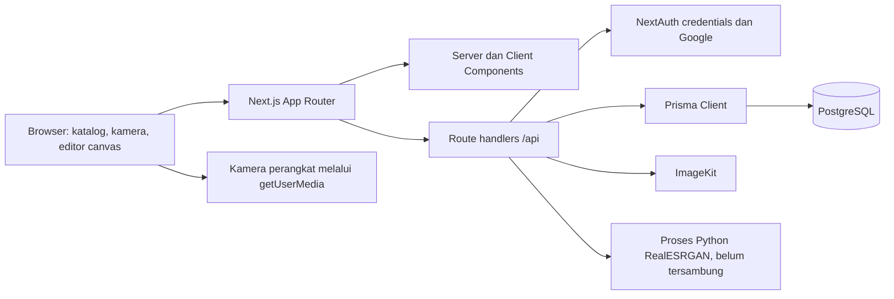
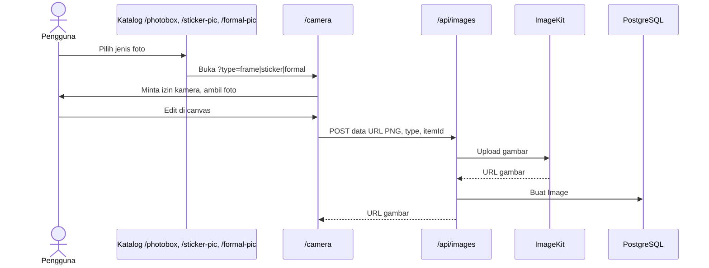

# Arsitektur PBOX

Dokumen ini menjelaskan batas komponen dan aliran data pada kode saat ini. Untuk langkah instalasi lihat [SETUP.md](../SETUP.md); untuk status dan risiko lihat [HANDOFF.md](HANDOFF.md).

## Gambaran sistem

`compose.yaml` hanya menjalankan PostgreSQL untuk pengembangan. Next.js dan Python dijalankan di host. Belum ada konfigurasi deployment aplikasi di repo.

## Batas komponen

| Bagian | Lokasi | Tanggung jawab |
| --- | --- | --- |
| Halaman dan layout | `src/app/` | Route publik, dashboard, admin, tampilan studio |
| Komponen studio | `src/components/camera/` | Akses kamera, editor frame/stiker/formal, hasil canvas |
| Komponen bersama | `src/components/` | Navigasi, landing, tema, komponen UI |
| Route handlers | `src/app/api/` | Validasi permintaan, akses data, upload, auth |
| Auth | `src/lib/auth.ts`, `src/middleware.ts` | Provider credentials/Google, sesi JWT, penjagaan halaman |
| Data | `prisma/schema.prisma`, `src/lib/prisma.ts` | Model dan Prisma Client |
| Media | `src/lib/imagekit.ts`, `src/lib/catalog-assets.ts`, `public/images/`, `assets/source/` | Upload ImageKit, pemetaan URL seed lama, dan aset statis lokal |

`src/app/layout.tsx` memasang `AuthProvider`, `ThemeProvider`, header, dan footer untuk seluruh halaman. Landing dirender dari `src/app/page.tsx`. Katalog menggunakan Prisma langsung pada Server Components; editor dan navigasi interaktif merupakan Client Components.

Aset contoh katalog disimpan secara lokal; [ASSETS.md](ASSETS.md) menjelaskan sumber dan turunan web. Saat database masih menyimpan URL `placehold.co` untuk entri seed, halaman dan route GET memetakannya ke file lokal saat membaca data. Baris lain tetap menggunakan URL dari database.

## Aliran utama

### Autentikasi

`POST /api/auth/register` membuat `User` dengan password bcrypt. NextAuth menyediakan login credentials dan Google melalui `/api/auth/[...nextauth]`, memakai Prisma Adapter dan strategi sesi JWT. `src/middleware.ts` mengalihkan pengguna tanpa token dari `/dashboard`, `/profile`, `/settings`, dan `/admin`; jalur admin juga memeriksa `role === "admin"`. Handler API admin memeriksa sesi dan peran lagi secara terpisah.

Perhatian: cabang credentials di `src/lib/auth.ts` hanya membandingkan password jika `User.password` tidak kosong. Ini membuat akun Google dengan password `null` berisiko dapat masuk lewat credentials menggunakan email dan password sembarang. Lihat [prioritas handoff](HANDOFF.md#batasan-dan-pekerjaan-lanjutan).

### Katalog dan foto

Frame mengambil koordinat `FramePlaceholder` dari `GET /api/frames/[id]`. Stiker dibaca dari katalog saat editor dibuka. Foto formal memakai `FormalPicture.sizes` dan gambar latar; editor tidak memisahkan subjek dari latar foto kamera. Hasil canvas disimpan melalui `/api/images`, yang saat ini belum memisahkan prefix data URL dari payload base64.

### Administrasi katalog

Admin membuat dan mengubah kategori, frame, dan stiker melalui halaman `/admin/*`. Formulir frame/stiker mengunggah aset ke `POST /api/files`, lalu menyimpan URL ke katalog. `POST /api/files` memerlukan peran admin. UI belum menyediakan editor koordinat `FramePlaceholder` atau CRUD latar formal.

## Model data

- `User` memiliki `Account` dan `Session`. `role` adalah string dengan nilai awal `user`; seed membuat admin.
- `Category` memiliki banyak `FrameCatalog` dan `StickerCatalog`.
- `FrameCatalog` memiliki banyak `FramePlaceholder` yang menyimpan `xPosition`, `yPosition`, `width`, dan `height`.
- `FormalPicture` menyimpan `backgroundUrl` dan JSON `sizes`.
- `Image` menyimpan `url`, `type`, dan `itemId`. Tidak ada relasi ke `User`, sehingga belum ada kepemilikan hasil foto per akun.

Skema dan aturan relasi yang tepat ada di [schema.prisma](../prisma/schema.prisma). Migration awal berada di `prisma/migrations/20250302172136_reset/`.

## Integrasi dan batas operasi

| Integrasi | Kebutuhan | Catatan |
| --- | --- | --- |
| PostgreSQL | `DATABASE_URL` | Database lokal dari Docker Compose pada host port `5433` |
| NextAuth | `NEXTAUTH_URL`, `NEXTAUTH_SECRET` | Google juga memerlukan client ID dan secret |
| ImageKit | Public key, private key, URL endpoint | Hasil foto dan aset yang diunggah admin berada di ImageKit; katalog seed memakai file lokal |
| Kamera browser | Izin kamera, secure context atau localhost | Hanya berjalan di sisi browser |
| RealESRGAN | Python, requirements, model | Path skrip dan model saat ini tidak cocok; bukan bagian alur kamera aktif |

Untuk menambahkan route API, periksa akses pada handler tersebut. Matcher middleware tidak mencakup `/api/*`. Untuk perubahan data, buat migration Prisma yang sesuai dan uji pada database pengembangan sebelum menerapkannya di lingkungan lain.
